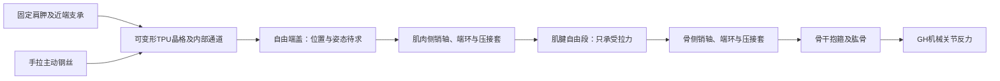

# 自由端、端环与肌腱：S1-Y2约束模型及局部运动检查

更新：2026-11-02。输入为[当前191对象装配](../assembly_check.json)，本轮不修改几何或候选指针。新增了可计算的端点／长度约束与局部端环检查，**没有求解完整肌肉平衡或实际驱动范围**。

## 真实连接与模型变量



两端端环具有真实槽环、M2销和压接套几何。局部转动只能绕各自销轴建立，不能添加不存在的空间固定导向。端盖通过TPU端垫／钩接触，端盖的空间位置和姿态由TPU变形、接触、钢丝与肌腱共同决定；没有依据把它绑到肱骨或固定在空间。

对给定肱骨姿态，每块肩袖肌的约束子模型包括端盖平移3、姿态3、肌肉侧眼环转动1、骨侧眼环转动1，共8个未知量。眼环与压接套的无滑移、理想销轴转动、钢丝不可伸长均为待验证假设。

## 肌腱有效自由段不是整根钢丝长度

源模型包含两处回折端环、两处压接套及尾段。按实际套筒外端面（局部u=8.9 mm，钢丝支路偏置v=+0.45 mm）求与记录中心线的交点，将路径分为肌肉侧局部段、中央自由段、骨侧局部段。三段长度守恒且两出口确实位于原路径；不重新猜测锚点。

| 项目 | 冈下肌FJ1500 | 肩胛下肌FJ1504 |
|---|---:|---:|
| 含端环／尾段的整根名义中心线 | 95.41817 mm | 92.12987 mm |
| 两压接套外出口间的名义自由段路径 | 39.92927 mm | 36.64097 mm |
| 零位出口直线距离 | 39.92595 mm | 36.14845 mm |
| 名义路径比直线长 | 0.00333 mm | 0.49253 mm |
| 实际安装自由长度／预紧力 | 未测 | 未测 |

这些是设计中心线长度，不能当作实物裁线尺寸、安装自由长度或预紧量。特别是“路径比直线长”只描述曲线几何，不是测得松弛。整根95／92 mm不能填进中央段的固定长度方程。零位0.6 mm直线钢丝包络对其余190对象无超0.001 mm³相交，说明该零位直线探针未受阻；不证明其他姿态直线可用或钢丝已张紧。

## 端点方程与张力约束

端点计算见[约束代码](../../../../../mujoco_arm/tools/shoulder_free_terminal_constraints.py)。A为肌肉侧出口，B为骨侧出口，x为自由端盖销心，R为端盖相对零位的旋转，Rh为绕GH的肱骨旋转；aA／aB为各自零位销轴，dA／dB为零位销心至出口向量：

```text
A = x + R Rot(aA, phiA) dA
Bpin = GH + Rh (Bpin0 - GH)
B = Bpin + Rh Rot(aB, phiB) dB
```

在中央段直线无阻、忽略弯曲刚度、两套筒无滑移及肌腱不可伸长的条件下：

```text
g = L_installed - |A - B| >= 0
tension >= 0
tension * g = 0
```

存在绕障碍时必须用真实路由长度替代直线距离，直线只能作为长度下界；本轮尚未实现变姿态绕障求解。L_installed保持未知，不用名义值冒充安装实测。

代码中的`evaluate_installed_strand`拒绝未知安装长度、未声明来源、未核查的直线或短于出口直线的所谓绕线路径。使用假设长度时必须标为`explicit_assumption`；即使几何条件满足，也只返回长度间隙，张力仍为未知，不返回已求解端盖或实际驱动范围。

张紧时该长度方程对8变量的雅可比秩为1，仍有7个运动未知量；松弛时这条约束不激活，不能以负张力“推回”端盖。这个欠定性不说明方案不可行，而是说明TPU的变形、力和接触必须参与求解。自由端盖还需满足力／力矩平衡，眼环还需满足销轴摩擦／止挡及局部力矩条件；内部主动钢丝沿弯曲通道的分布反力也不能只用一根肌肉中心线力代替。

[独立验证](verification_checks.json)用16个不同位置、姿态与眼环角的合成代数状态验证雅可比，中央差分最大逐分量差约1.1e−7（各分量按其对应单位比较）。这些状态没有被认定为碰撞可达或平衡姿态。

## 零位局部端环转动检查

每次只转一端的实际槽环、未压接套及局部端环／尾线，围绕真实销轴；端盖、抱箍、其他零件均保持零位。自己的整根原肌腱网格从该步骤移除，中央段和对侧局部钢丝没有被求解或显示为正确路由。局部组刚性转动是几何诊断，不是钢丝弯曲或真实压接保持模型。

| 端部 | 负向最后未超判据采样 | 正向最后未超判据采样 | 首个超判据刚性对象 |
|---|---:|---:|---|
| 冈下肌：肌肉侧 | −180°检查上限 | +10.9° | 正向自由端盖 |
| 冈下肌：骨侧 | −5.1° | +152.9° | 两方向抱箍上半夹体 |
| 肩胛下肌：肌肉侧 | −14.5° | +180°检查上限 | 负向自由端盖 |
| 肩胛下肌：骨侧 | −165.1° | +19.3° | 两方向抱箍下半夹体 |

上述正负是各端记录销轴的方向，不是人体内外旋，亦不等于GH角度。常规1°、刚性首界细化0.1°，清采样独立回程；14个清边界／首限姿态另用独立形成的旋转变换重放一致。判据0.001 mm³是体积报告门槛，多个最后采样的最小间隙为0，不代表严格零穿透或正制造间隙。

TPU没有整对忽略：另外记录所有未变形TPU相交。冈下肌肌肉侧负向首次细化采样接触三角肌约−123.8°，骨侧正向约+75.1°，早于相应刚性首限。柔性接触尚无变形求解，因此既不直接判失败，也不把表中刚性范围当作柔性通过范围。±180°只表示本次扫描上限，未排除后续转动或其他方向限制。

## 下一步需要的数据

优先确认4个肌腱套筒的实际压接保持、安装后两出口间材料长度与预紧，测局部端环在负载下的摩擦和止挡；再记录拉线过程中的端盖位置／姿态、TPU缩短、张力与卸载恢复。[空白记录](measurement_template.json)全部未测，不覆盖已有单肌肉记录。

这些数据与单肌肉变形标定一起进入自由端盖平衡和变姿态路由求解。暂不为扩大端环转角裁削端盖／抱箍，因为实际所需眼环角尚未由耦合模型确定。骨架、钢丝锚点与默认S1-Y2保持不变。

## 复现

项目根目录，在带numpy、manifold3d及项目`.deps`的几何环境执行：

```powershell
python mujoco_arm/tools/audit_shoulder_free_terminal_kinematics.py
python mujoco_arm/tools/verify_shoulder_free_terminal_kinematics.py
```

[主报告](kinematics_audit.json)记录完整局部路径、源哈希、未知量、方程和往返采样。[验证报告](verification_checks.json)记录数值导数、独立边界重放、TPU接触细化与零位直线探针。所有报告`stage_pass=false`，实际肩部驱动范围未知。
