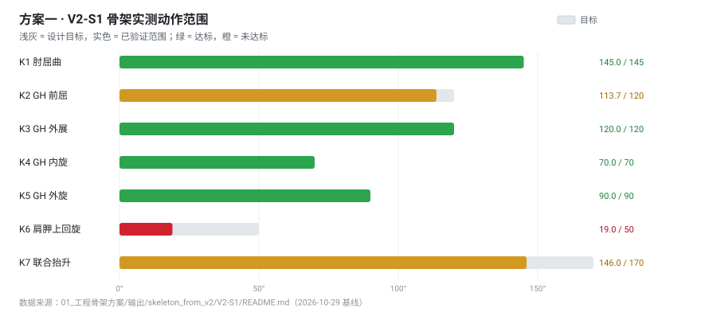
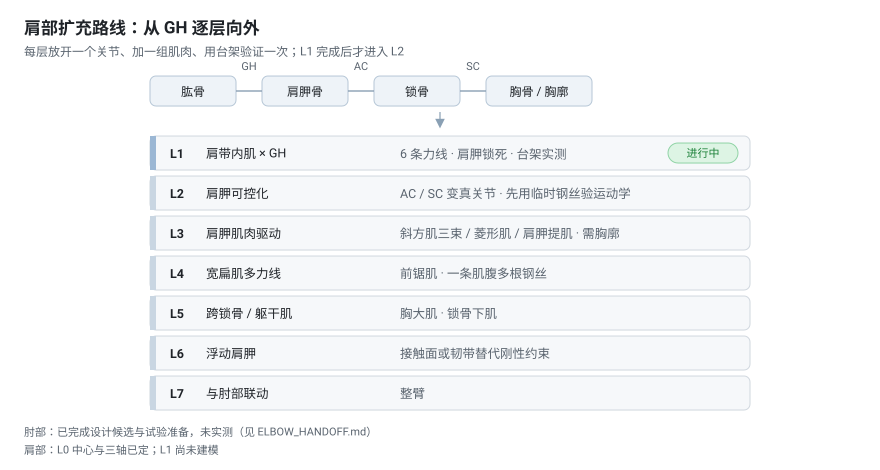

# 仿生右臂 · 人体骨骼 + 工程关节 + 异形 TPU 晶格肌肉

用真实人体骨骼与解剖肌肉几何做一条可用钢丝驱动的右臂，再和人体对比——**差在哪、最大能到多少运动范围**。

**当前阶段**：肘部设计候选已交付（未实测）；肩部完成设计分解，准备进入 **L1（GH 单关节）**。
**最新周报**：[2026-11-01](reports/2026-11-01.md) · [全部周报](reports/README.md)


## 进度

| | 状态 |
|---|---|
| **肘部** | ✅ 设计候选已交付：127 件零位装配、125 实体 STEP、刚性 0–150° 266 条件姿态。**未实测** |
| **肩部** | 🔶 L0 定为**开放浅窝**（D15）；L1 已完成九件实测（力线符号 6/6、两端 10 个骨侧座、六块肌包络、12 个端的内切圆、S1-P0 的 4 个 z 样件、夹持区可达性、三角肌 Y 包络、通道走法与**路径搜索**）；**通道：5/6 够用，中束缺 4.27 mm**；**夹具 D17（两组、不跨窝）**；尚未建模；L2 起未开始 |
| **工具链** | ✅ 肌肉→TPU 的 skill、坐标 / 力线 / 干涉三个模块，均带自检与回归 |
| **实物** | ⬜ 未开始：打印、压接、台架 |

## 已完成 / 未验证

这一栏是本项目最重要的纪律：**几何通过 ≠ 能用**。

| 已完成（有几何或脚本证据） | 未验证（不要当成结论） |
|---|---|
| 127 件零位装配，125 实体 STEP 回读有效 | TPU 实际可驱动范围（**未知**） |
| 两块肌肉各为单一连通实体，钢丝名义相交 0 | 通道能否打印、弯曲后是否闭塞 |
| 刚性肘 0–150°，266 条件姿态 + 独立回程无碰撞 | 连续管壁带来的收缩阻力与卡线 |
| 销轴捕获：外移 0.09 mm 不碰、0.11 mm 挡住 | 防脱力、防松、振动寿命 |
| 四类打印对比样件 + 12 行空白测量记录 | 压接夹持力（压接坯仍是名义几何） |
| 坐标链自检 dE = 0、dF = 0 | 台架夹具柔度（唯一必须实物标定的项） |
| 力线回归：−71.309 mm / +95.804 mm 与旧记录一致 | 完整装配（TPU + 钢丝 + 电机 + 导管） |
| 干涉判据统一后可复现存档（0.0250 / 0.0873 mm³） | 肩部：**只有几何检查，没有实物** |
| 肩部：6 条力线零位符号 6/6；肱骨侧 4 个止点座互不重叠、不碰原生肩胛骨 | 肩部浅窝的接触应力、磨损、实际防脱 |
| 肩部：六条力线沿盂法线的压紧分量 6/6 为正（最小 0.282） | 该分量只是**方向**，没有力的大小与摩擦 |
| 肩部：D15 开放浅窝的裸骨扫掠（外展 119.38°、轴向 +97.44°/−122.88°） | 未含 2 mm 软衬与肌腹包络，实际范围更小 |
| 肩部：六块肌包络实测（骨修剪 ≤9.8%、通道壁 ≥1.69 mm、三角肌形心偏移 35 mm） | 截面只取 13 站，修剪后的网格尚未重生成 |
| 肩部：12 个肌腹端内切圆实测，8 个可直接沿用肘部过渡环、4 个需局部加座 | 加座形状与撞骨未建模 |
| 肩部：起点侧 6 座排布，15 对全不重叠、4 座零抬升、2 座需抬 0.86/1.55 mm | 未与 §5.9 夹具夹持区、肌腹包络做联合检查 |
| 肩部：S1-P0 的 4 个 z 样件几何，格子经重建肘部 C0/C3 验证，体积与包围盒已定 | 打印与 E_x/E_y 全部未测；标定曲线还不存在 |
| 肩部：四个夹持区直杆可达性实测——喙突两侧都够不到，背侧可达两点共线 | 夹爪/横梁实体、两组向外引出、底座均未做 |
| 肩部：夹具拓扑 D17——贴面版六向扫到 120° 全通；去掉跨窝三角梁后肩胛下肌只剩 6.2 mm³ | 内侧/外侧两组各自的引出路径未建；垫抬升 0.66 mm 后的楔形缝未定 |
| 肩部：三角肌 Y 包络——减骨后单连通块 316 cm³，三孔共享端垫成立（净隙 5.23 mm） | 三条通道三种走法全部出体；Y 的共干段必须重构，通道要路径搜索 |
| 肩部：六条力线通道走法逐条判定——三种启发式全不成立；越界 +0.94…+4.68 mm | 只是启发式，失败 ≠ 无可行路径 |
| 肩部：**通道路径搜索**——六条里 **5 条够用**（最浅处 −1.91…−7.16 mm），只有三角肌中束缺 4.27 mm | 是局部松弛不是全局搜索；外扩后尚未重查与骨/邻肌/夹具的净距 |

## 两方案思路

两条路线**不互相继承尺寸、锚点或通过结果**。方案一并未放弃，只是目前没有达到设想，现处于并行评估中。

### [方案一 · 工程骨架 + 钢丝驱动](01_工程骨架方案/README.md)（并行评估中）


**做法**：不使用人体模型，人工设计骨架——胸廓取 R400 曲面、锁骨 150 mm、肩胛板厚 5 mm、
肱骨 GH–E 290 mm；预设一条 **7 自由度链**（SC 十字轴 → 锁骨 → AC → 肩胛 → GH 三铰链 → 肱骨 → 肘）；
先冻结锚点表，再用 **16 根钢丝**分四组（E 肘 / G 盂肱 / S 肩胛 / P 胸大肌）驱动，
在 MuJoCo 里用理想拉线执行器复现 K1–K7 动作组。



**已经达到的**：K1 肘 145°、K3 外展 120°、K4 内旋 70°、K5 外旋 90° 全部命中目标；
K7 联合抬升到 146°（目标 170°）；16 钢丝演示全部产生可见运动。

**没解决的**：

1. **肩胛骨与各肌肉的锚点很难确定。** 真实肩胛与胸廓之间没有骨性关节，靠肌肉张力和接触面撑着；
   人工骨架上只能用一条解析曲面近似，结果 K6 上回旋只到 **19°（目标 50°）**、K7 只到 **146°（目标 170°）**，
   再增加轮廓切除就超出保留形态的预算。
2. **即使强行确定锚点，这条手臂与"仿生"的关系也不大了。** 骨架形状是人为设定的、
   肌肉附着位置是设计者指定的——它验证的是机构逻辑，不是解剖结构。

### [方案二 · 人体骨骼 + 工程关节 + TPU 晶格肌肉](02_人体骨骼晶格肌肉方案/README.md)（当前推进）



**起因**：Yoshimura 等 2026《Accelerating Musculoskeletal Robotics Through Parametric Design
and 3D-Printed Flexible Structures》——把肌肉体积参数化成 TPU 晶格 + 连续钢丝通道，
用同一套工艺做肌肉、肌腱、韧带与缓冲件。

**目标不是"证明能造出来"**，而是：用真实解剖几何强行做一遍，
再和人体手臂比——**差别在哪、最大能到多少运动范围**。

**做法**：

1. 几何改用真实 BodyParts3D 骨骼（5 块）与解剖肌肉（27 块），不继承旧骨架；
2. 关节做成实物（SC / AC / GH 球副、肘铰链，含保持盖与紧固件），而不是理想约束；
3. 每块异形 TPU 肌腹内部有**连续钢丝通道**，钢丝在肌腹内传力，端部用刚性端盖与压接止挡；
4. 验证降到"**手拉钢丝能重复往返**"这一级，不要求电机与外部导管；
5. 肩部按 **L0–L7 逐层**推进：每层放开一个关节、加一组肌肉、台架验一次，上一层没验完不进入下一层。

**已经交付的**：肘部设计候选——127 件零位装配、125 实体 STEP、刚性 0–150°（266 条件姿态 + 独立回程）、
两块真实连续通道 TPU、四类打印对比样件；肩部技术文档与 L0–L7 路线；
以及坐标 / 力线 / 干涉三个带回归的工具模块。

**当前的未知**：TPU 实际能驱动的范围——**仍未测**，0–150° 只是刚性路径，不是肌肉能力。

### 两条路线的差别

| | 方案一 | 方案二 |
|---|---|---|
| 骨骼几何 | 人工设计 | 真实 BodyParts3D |
| 肌肉锚点 | 预先设定并冻结 | 由解剖结构决定 |
| 驱动方式 | 16 根钢丝直接拉关节 | 肌肉本体传力（钢丝在肌腹内） |
| 验证方式 | MuJoCo 动作复现 | 几何门 + 台架手拉 |
| 要回答的问题 | 机构能否复现指定动作 | 与人体差多少、极限在哪 |

肩部技术文档：[SHOULDER_DESIGN.md](02_人体骨骼晶格肌肉方案/输出/shoulder_design/SHOULDER_DESIGN.md)。

## 仓库导航

```
02_人体骨骼晶格肌肉方案/    当前主线
  ├─ 输入/                  人体骨骼 + 已筛选肌肉（BodyParts3D, CC BY-SA 2.1 JP）
  ├─ 输出/anatomical_concept/ 肘部候选、接口、试验样件、诊断
  └─ 输出/shoulder_design/    肩部技术文档
01_工程骨架方案/            方案一（并行评估中）
00_共用资料/                文献知识库、设计历史总账
mujoco_arm/                 源码（场景、建模、审计脚本）
.cursor/skills/             可复用流程（肌肉 → TPU 的完整做法）
mujoco_arm/tools/           frames / force_line / interference（带自检与回归）
docs/                       首页用的图
reports/                    每周汇报
```

## 快速复现

```powershell
git lfs install && git lfs pull          # 模型与图片走 LFS

python mujoco_arm/tools/frames.py                              # 坐标自检
python mujoco_arm/tools/force_line.py --self-test              # 力线解析自检
python mujoco_arm/tools/force_line.py --muscle FJ1486 --to 150 --step 1 --bone
python mujoco_arm/tools/regression_interference.py             # 干涉模块回归

python mujoco_arm/anatomical_concept/view_continuous_elbow.py  # 肘部零位
python mujoco_arm/anatomical_concept/view_paired_swivel.py --keepers --motion  # 刚性动画
```

环境与依赖说明见 [RUNNING.md](RUNNING.md)。MuJoCo 资源由 Python 读入内存后交给原生接口，
因此项目可以放在含中文的路径下。

## 工作原则

1. **结论边界**：几何与数值检查只能写成"几何通过"，不等于能驱动、能打印、能装配。
2. **分步验证**：每层先设可复算的门，上一层没验完不进入下一层；失败记录保留不覆盖。
3. **单一事实源**：坐标只在 `frames.py`、力线只在 `force_line.py`、干涉判据只在 `interference.py`，
   避免同一件事在十几个脚本里各写一遍。

---

<sub>文献依据与方法来源见 [knowledge_base](knowledge_base/README.md)；人体模型来自 BodyParts3D（CC BY-SA 2.1 Japan）。</sub>
