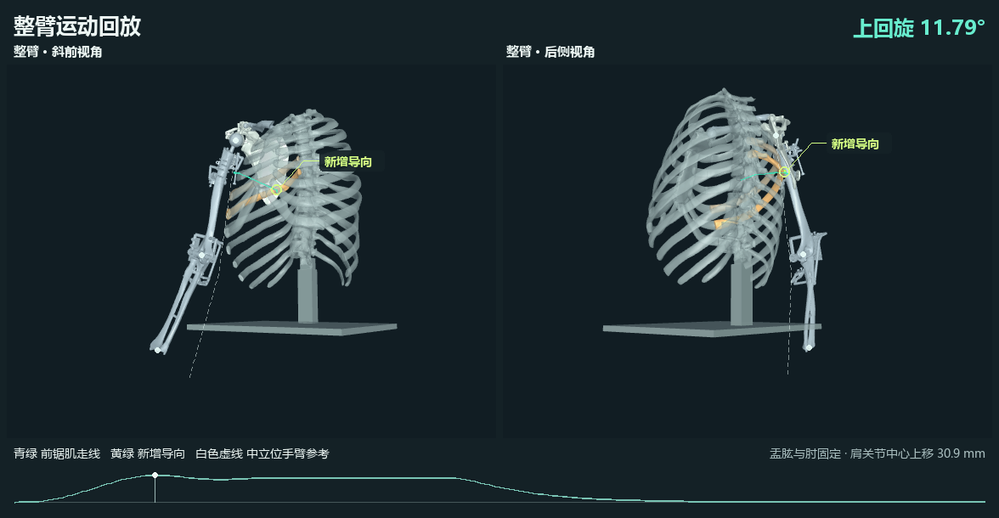
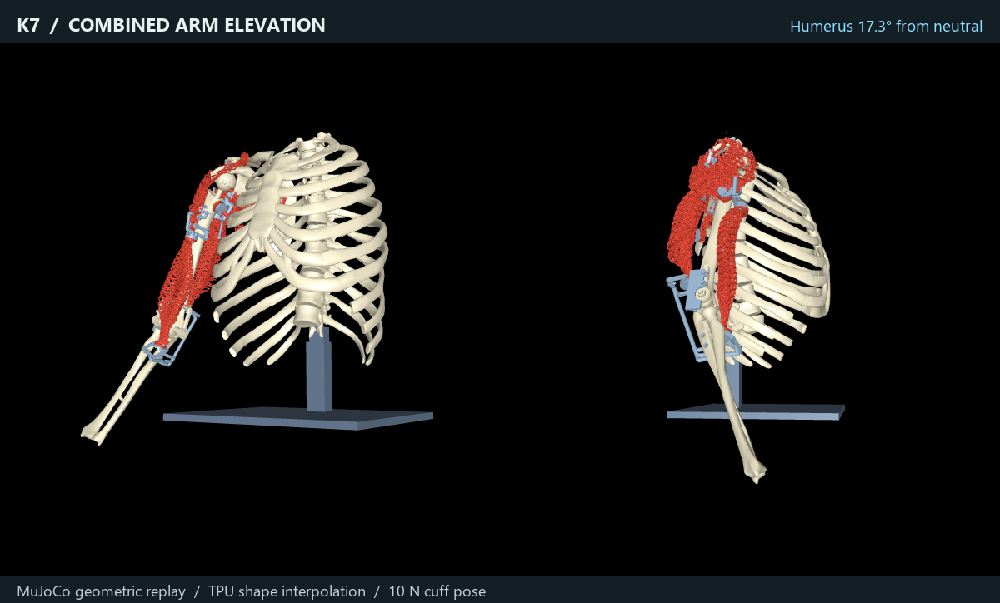
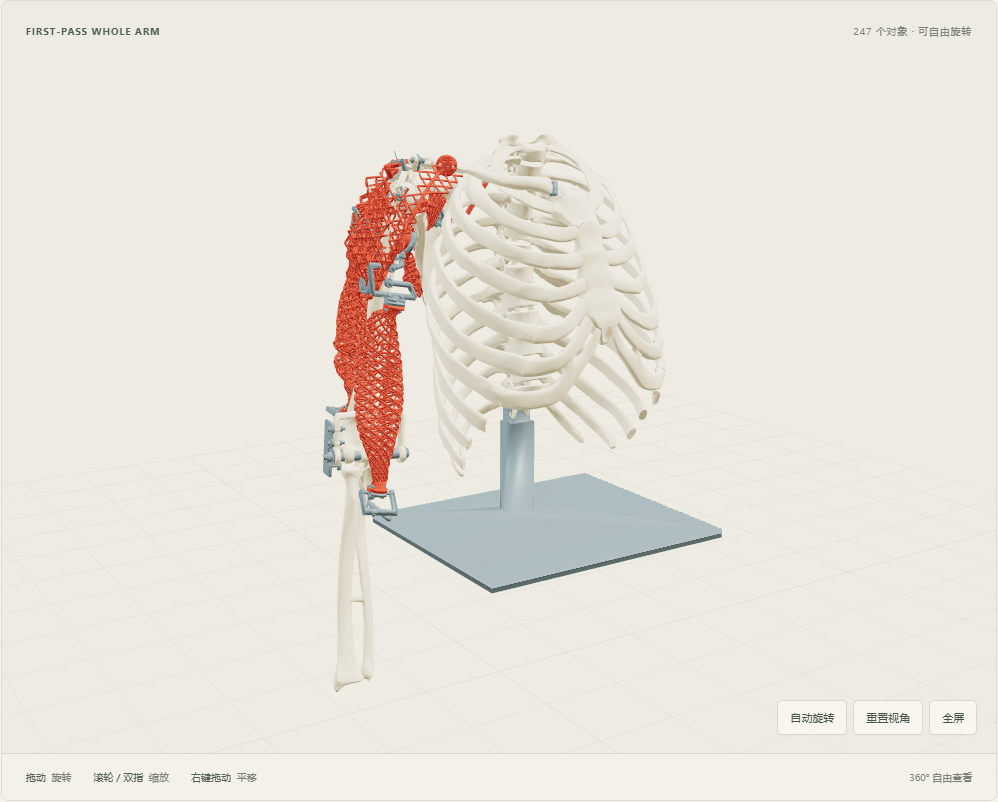
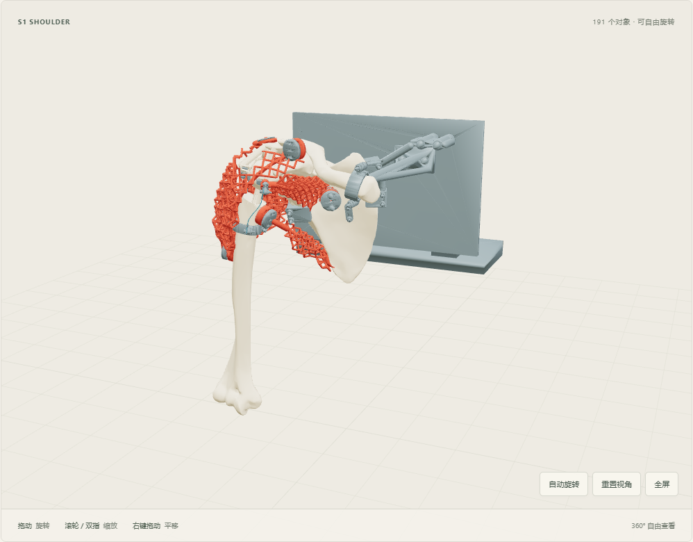
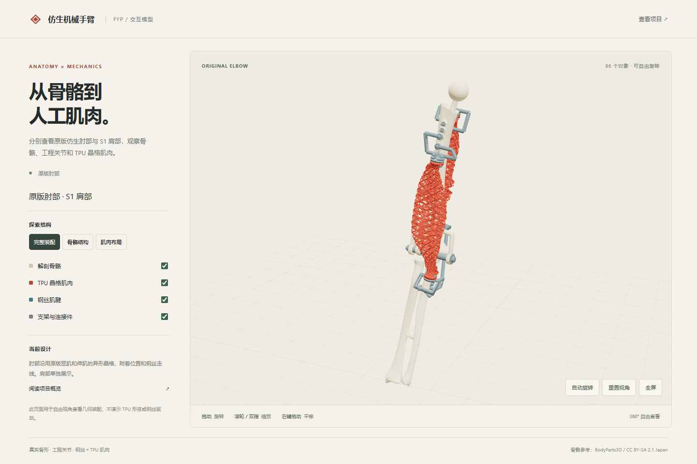

# 仿生右臂：人体骨骼＋工程关节＋异形 TPU 晶格肌肉

**整臂首版可查看。** 桌面胸廓、肩胛、肩部 S1、肘部、八块 TPU 和回位弹簧已合入同一套设计。交付文件包含 K7 动画、十条局部钢丝与导向坐标、K1–K7 的几何范围和待验证项。[整臂首版](02_人体骨骼晶格肌肉方案/输出/whole_arm_first_pass/README.md)

[项目概览](docs/PROJECT_OVERVIEW.md) · [整臂首版技术方案](design/WHOLE_ARM_FIRST_PASS.md) · [首版 Goal](design/WHOLE_ARM_GOAL.md)

以真实解剖骨骼为基础，通过工程关节保证运动，以钢丝和可变形 TPU 晶格肌肉传力。允许短钢丝肌腱连接骨侧接口。

首版登记十条局部钢丝路径、锚点与导向，整臂供线留到后续阶段。[钢丝与接口交接表](02_人体骨骼晶格肌肉方案/输出/whole_arm_first_pass/whole_arm_cable_handoff.md)

## FYP 进度演示

### 肩胛主动上回旋 · K6

[](https://dumbfoxxxxy.github.io/biomimetic-arm-fyp/showcase/#scapular-routing)

新增一处前锯肌钢丝导向后，单轴主动上回旋仿真由 **4.15°** 提高到 **11.79°**，并完成回位。约 11.8° 时前锯肌力臂变号。**27.50°** 为该路径的几何检查范围。前伸间隙和实际导向安装仍待验证。

**[播放整臂回放](https://dumbfoxxxxy.github.io/biomimetic-arm-fyp/showcase/#scapular-routing)** · [走线报告](02_人体骨骼晶格肌肉方案/输出/whole_arm_first_pass/scapular_control/ROUTING_REFINEMENT.md) · [局部锚点及反力](02_人体骨骼晶格肌肉方案/输出/whole_arm_first_pass/scapular_control/serratus_guide_points.csv)

### OpenSim 解剖对照

在整臂中立位叠加 **17 条人体肌束、10 条工程钢丝路线和骨面候选点**。该对照展示首版走线，新增导向候选见上面的 K6 回放。

**[打开 360° OpenSim 对照](https://dumbfoxxxxy.github.io/biomimetic-arm-fyp/?model=first-pass&compare=opensim&v=opensim-1)** · [技术报告](02_人体骨骼晶格肌肉方案/输出/whole_arm_first_pass/OPENSIM_COMPARISON.md) · [逐束数据](02_人体骨骼晶格肌肉方案/输出/whole_arm_first_pass/opensim_comparison.csv)

### 整臂联合抬升

[](https://dumbfoxxxxy.github.io/biomimetic-arm-fyp/showcase/#motion)

**[播放首版整臂动画](https://dumbfoxxxxy.github.io/biomimetic-arm-fyp/showcase/#motion)** · [查看 K1–K7 范围](02_人体骨骼晶格肌肉方案/输出/whole_arm_first_pass/README.md)

K7 联合抬升的肱骨方向变化约 **17.33°**。同一设计的 K1 八线几何回放达到 **31.31°**。整臂独立驱动、TPU 受载接触和实物行程仍待验证。


| 入口 | 内容 |
|---|---|
| [PROJECT_STATUS](PROJECT_STATUS.md) | 唯一当前状态入口 |
| [肩肘组合、时序和内线验证](02_人体骨骼晶格肌肉方案/输出/integration_review/s1_series_elbow/README.md) | 早期肩肘局部研究与回放 |
| [肩部 S1 技术方案](02_人体骨骼晶格肌肉方案/输出/shoulder_design/SHOULDER_DESIGN.md) | 传力链、证据、限制及待讨论方向 |
| [当前有效规格](design/CURRENT_BASELINE.md) | 用户要求、比较指标与验收边界 |
| [设计任务书](design/DESIGN_BRIEF.md) | 当前入口与历史设计记录 |
| [运行说明](RUNNING.md) | 环境、依赖及查看方式 |

## 360° 交互模型

[](https://dumbfoxxxxy.github.io/biomimetic-arm-fyp/?model=first-pass&v=first-pass-1)

**[打开整臂首版 3D](https://dumbfoxxxxy.github.io/biomimetic-arm-fyp/?model=first-pass&v=first-pass-1)** · [查看先前肩肘组合](https://dumbfoxxxxy.github.io/biomimetic-arm-fyp/?model=combined&v=combined-1)

| S1-Y2 肩部 | 原版仿生肘部 |
| :---: | :---: |
| [](https://dumbfoxxxxy.github.io/biomimetic-arm-fyp/?model=shoulder&v=original-elbow-2) | [](https://dumbfoxxxxy.github.io/biomimetic-arm-fyp/?v=original-elbow-2) |
| [打开肩部 3D](https://dumbfoxxxxy.github.io/biomimetic-arm-fyp/?model=shoulder&v=original-elbow-2) | [打开肘部 3D](https://dumbfoxxxxy.github.io/biomimetic-arm-fyp/?v=original-elbow-2) |

两个视图均可拖动旋转、缩放和平移，也可切换骨骼、肌肉、钢丝和连接件图层。肘部沿用原版屈肌、伸肌、附着点和走线。 [本地查看与部署说明](docs/GITHUB_MODEL_VIEWER.md)

当前肩肘组合轨迹可在本地查看。`python tools/view_s1_series_elbow_start_pose.py --case seating_k5`。[肩肘组合与验证记录](02_人体骨骼晶格肌肉方案/输出/integration_review/s1_series_elbow/README.md)

## 方案与目录

| 目录 | 用途 |
|---|---|
| [02_人体骨骼晶格肌肉方案](02_人体骨骼晶格肌肉方案/README.md) | 当前主线；输入骨骼／肌肉、肘部候选、肩部审查 |
| [01_工程骨架方案](01_工程骨架方案/README.md) | 历史路线对照；通过结果不转移到新骨骼 |
| `mujoco_arm/` | 场景、建模、查看及检查脚本 |
| [knowledge_base](knowledge_base/README.md) | 文献与方法参考 |
| `reviews/` | 版本审查、证据和文档快照 |
| `design/` | 有效规格、任务书和打印参考 |

最新肩部候选包含GH机械保持关节、60 mm骨干抱箍、两块肩袖肌自由末端／肌腱、近端支承、肩胛三夹区及锁骨抱夹／背板支承。已有网格、孔路、零位钢丝和有限接触检查，真实夹紧、完整装配、通道壁、压接、柔性运动及实物性能仍待验证。24／34／46对象的旧刚性范围不适用于72／92对象自由末端结构。最新几何入口、证据边界和原K1–K7指标见肩部技术方案。

本页旧进度与两路线比较保存在 [整理前快照](reviews/S1_2026-11-02/document_cleanup_before/README.md)。以下命令用于已有候选复现，不代表运行后即完成实体验收。

## 快速复现

当前肩部使用以下只读入口，分别查看完整零位模型和裸骨规定运动，均不展示TPU实际驱动：

```powershell
python mujoco_arm/tools/view_shoulder_manufactured.py
python mujoco_arm/tools/view_shoulder_bare_GH_motion.py
```

肘部查看与已有分析工具另列如下，其结果须按各自输入和阶段解释：

```powershell
git lfs install && git lfs pull          # 模型与图片走 LFS

python mujoco_arm/tools/frames.py                              # 坐标自检
python mujoco_arm/tools/force_line.py --self-test              # 力线解析自检
python mujoco_arm/tools/force_line.py --muscle FJ1486 --to 150 --step 1 --bone
python mujoco_arm/tools/regression_interference.py             # 干涉模块回归

python mujoco_arm/anatomical_concept/view_continuous_elbow.py  # 肘部零位
python mujoco_arm/anatomical_concept/view_paired_swivel.py --keepers --motion  # 刚性动画
```

环境与依赖说明见 [RUNNING.md](RUNNING.md)。MuJoCo 资源由 Python 读入内存后交给原生接口，
因此项目可以放在含中文的路径下。

## 工作原则

1. **结论边界**：几何与数值检查只能写成"几何通过"，不等于能驱动、能打印、能装配。
2. **分步验证**：每层先设可复算的门，上一层没验完不进入下一层；失败记录保留不覆盖。
3. **单一事实源**：坐标只在 `frames.py`、力线只在 `force_line.py`、干涉判据只在 `interference.py`，
   避免同一件事在十几个脚本里各写一遍。

---

文献依据与方法来源见 [knowledge_base](knowledge_base/README.md)。BodyParts3D, © The Database Center for Life Science licensed under CC Attribution 4.0 International. 本项目包含源解剖网格以及加装工程关节、固定和让位结构的派生网格。历史下载包标有 CC BY-SA 2.1 Japan。[BodyParts3D 授权说明](https://dbarchive.biosciencedbc.jp/en/bodyparts3d/lic.html)
